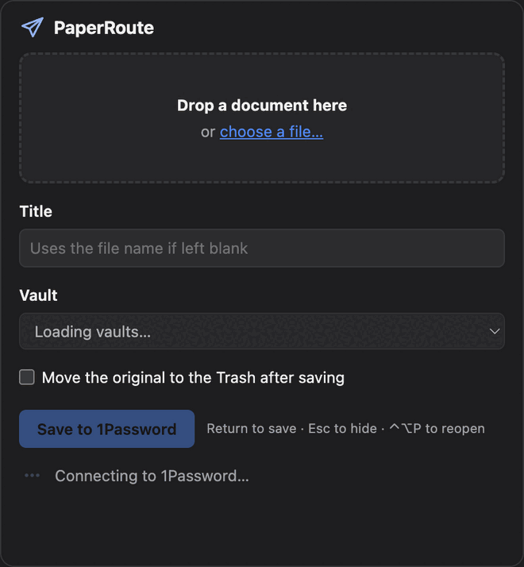

# PaperRoute

> **Version 0.1 — early and in progress.** PaperRoute works end to end, but it is young: expect rough edges, and the build is not yet signed with an Apple Developer ID. Issues and feedback are welcome.

A small macOS utility for uploading a document to a 1Password vault with as little friction as possible. Built on the official [1Password JavaScript SDK](https://github.com/1Password/onepassword-sdk-js), with Touch ID authentication from the 1Password desktop app.

<p align="left">
  
</p>

## What's included

- **A menu-bar app.** A paper-plane icon in the menu bar, no Dock icon. Press **Control-Option-P** to open a small window: drop a document, check the title and vault, press Return. The last vault you used is already selected.
- **A Finder Quick Action.** Right-click a file → **Quick Actions → Save to 1Password with PaperRoute**, and the window opens with that file loaded. Installed from the app's own menu.
- **Other ways in:** drop a file on the menu-bar icon, or choose one with a file picker.
- **Optional clean-up.** A checkbox moves the original to the Trash once the document is safely in 1Password.

What PaperRoute never does: it stores no tokens or passwords, uses no service accounts, and never reads 1Password's own files. Every session is approved by you, in the 1Password app, the same way you unlock it.

## Requirements

- **macOS** on Apple silicon (an Intel build can be made from source).
- **The 1Password desktop app**, with **Settings → Developer → Integrate with 1Password SDKs** turned on. 

## Installation

1. Open `PaperRoute-<version>-<arch>.dmg` and drag **PaperRoute** to **Applications**.
2. Open it from Applications. PaperRoute isn't signed with an Apple Developer ID yet, so macOS may refuse the first time: go to **System Settings → Privacy & Security**, find the message about PaperRoute, and choose **Open Anyway**. You only do this once.
3. Click the paper-plane icon in the menu bar and choose **Install Finder Quick Action…**. The same menu item removes it again.

To build the disk image yourself, see [Development](#development).

## Using PaperRoute

### The first time

PaperRoute asks which 1Password account your documents should go to. Open 1Password and copy the name at the very top of the sidebar, above your vaults, then enter it and press Continue. PaperRoute checks the name with 1Password straight away and tells you if it doesn't match. It's forgiving about capitals and apostrophe style, but otherwise the name must match exactly: there's no way for an app to list your 1Password accounts for you.

Approve the request in 1Password. The approval is 1Password's to give and take away: it covers PaperRoute while it's running, and ends when 1Password locks or after ten minutes without use. After that, PaperRoute simply asks again next time.

To switch to a different account, or to leave nothing behind on a shared Mac, choose **Choose Account…** from the menu-bar icon. PaperRoute forgets the current account and restarts onto the first-run screen, which is also what ends 1Password's approval (it belongs to the running process, and nothing inside the app can revoke it). Nothing in 1Password is changed.

### Saving a document

1. Give PaperRoute a document: right-click it in Finder and choose **Quick Actions → Save to 1Password with PaperRoute**, drop it on the window or the menu-bar icon, or press **Control-Option-P** and choose a file.
2. The title, which becomes the item's name in 1Password, fills in from the file name without its extension, selected so you can retype it. The vault you used last time is already chosen.
3. Press **Return**. **Esc** hides the window.

If a document with the same title is already in the vault, PaperRoute asks before saving another. If you hand it a file while a save is in progress, that file waits and loads when the save finishes. With several files selected, the first is used and PaperRoute says how many were left out. Saved documents are tagged `paper-route`.

### Moving the original to the Trash

Tick **Move the original to the Trash after saving** to clean up as you go. The file is moved only after the document has been read back from 1Password and matched byte for byte, and only if it hasn't changed since it was read. It goes to the Trash, not deleted, so it can be recovered. The setting is remembered.

### If something doesn't work

- **The Quick Action isn't in the right-click menu.** New Quick Actions can start switched off. Turn it on in **System Settings → General → Login Items & Extensions → Extensions → Finder** (click the ⓘ). It's also available under **Services** at the bottom of the right-click menu.
- **"Waiting for 1Password"** means 1Password is showing you an approval prompt, or is locked. Unlock it or approve the request, and PaperRoute carries on.
- **"PaperRoute can't find the 1Password account … any more."** The account was renamed or signed out of 1Password. Check its name at the top of the 1Password sidebar and enter it again.
- **Large files.** The 1Password SDK can't accept files over about 14 MB. PaperRoute says so before asking for approval.

Settings (the account name, the last vault and the Trash option) are kept in `~/Library/Application Support/paper-route/settings.json`. Nothing secret is stored there.

## Development

Building from source needs **Node 20 or later** (and macOS, for packaging and the Quick Action). `npm run dmg` builds the disk image into `out/`.

```sh
npm install
npm start              # build and run from source
npm test               # unit tests against an in-memory fake; never prompts
npm run typecheck
npm run build          # compile to dist/ (npm start does this too)
npm run package        # build out/PaperRoute-darwin-<arch>/PaperRoute.app
npm run dmg            # package, then build out/PaperRoute-<version>-<arch>.dmg
npm run demo           # re-record docs/demo-dark.gif from the built window
npm run render-icons   # re-render the menu-bar and app icons from assets/*.svg
npm run install-quick-action     # Quick Action for this source copy (the packaged app installs its own)
PAPER_ROUTE_USER_DATA=/tmp/pr-test npm start   # run with separate settings, e.g. to see the first-run screen
PAPER_ROUTE_LIVE=1 npm test   # also runs the live test against the real app (one prompt)
```

The live test creates one small document in the vault named by `PAPER_ROUTE_TEST_VAULT` (default `PaperRouteTest`) and deletes it again.

### Testing the core from the command line

A small CLI exercises the core library (`src/core/`) against the real 1Password app without the window, which is useful when changing the save logic or chasing an SDK behaviour.

```sh
export PAPER_ROUTE_ACCOUNT="<account name as shown in the 1Password sidebar>"

npm run vaults                                   # list vaults with their ids
npm run save -- ~/Downloads/receipt.pdf --vault PaperRouteTest
npm run save -- scan.pdf --vault <vault-id> --title "Dentist, March" --tag receipts
```

The first call prompts for approval in the 1Password app. If two vaults share a name, `--vault` must be the id. A second document with the same title in the same vault is refused unless you pass `--allow-duplicate`. Every failure prints as one line with its error code, the same codes the window switches on.

If Electron starts and immediately exits with an error about `app` being undefined, `ELECTRON_RUN_AS_NODE` is set in your shell (VS Code's terminal sets it). `npm start` clears it; to run Electron by hand, use `env -u ELECTRON_RUN_AS_NODE npx electron .`. The packaged app ignores the variable (see Packaging).

### Layout

- `src/core/` — everything that talks to 1Password, with no UI dependencies. `Session` owns the one long-lived SDK client; `saveDocument` reads a file, checks it fits, creates the item, reads it back and verifies the bytes; `listVaults` and `findVault`; `PaperRouteError` with a `code` the UI can switch on.
- `src/app/` — the Electron main process. `main.ts` sets up the menu-bar icon, shortcut and window; `handlers.ts` implements each request from the window; `account-names.ts` decides which spellings of an account name to try; `handoff.ts` takes files from Finder, the menu-bar icon and other launches; `quick-action.ts` builds the Finder Quick Action's workflow; `preload.cts` is the only bridge into the sandboxed window. Everything but `main.ts` and the preload is free of Electron imports, so it can be tested.
- `src/renderer/` — the window: a sandboxed page with no Node access.
- `src/shared/` — types, the window ↔ main-process API, and `window-logic.ts`: the window's decisions (when to offer Try Again, when a 1Password prompt is likely, how titles are filled in), kept out of the DOM code so they can be tested.
- `src/cli.ts` — the testing CLI, built on the core.
- `scripts/` — packaging (`package.mjs`, `make-dmg.mjs`), icon rendering, the development Quick Action installer, and the demo recorder (`demo/`).
- `assets/`, `build/`, `docs/` — icon sources and outputs, the entitlements, and the demo.

